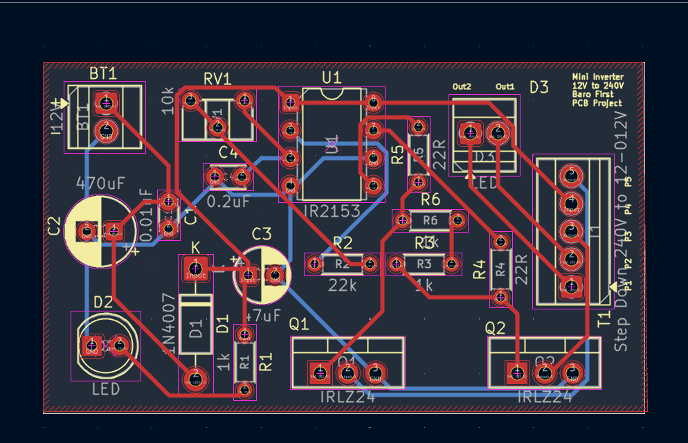
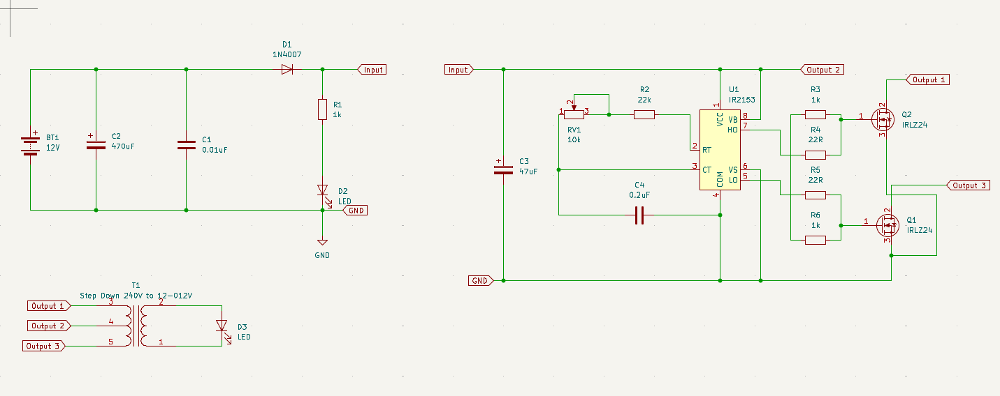
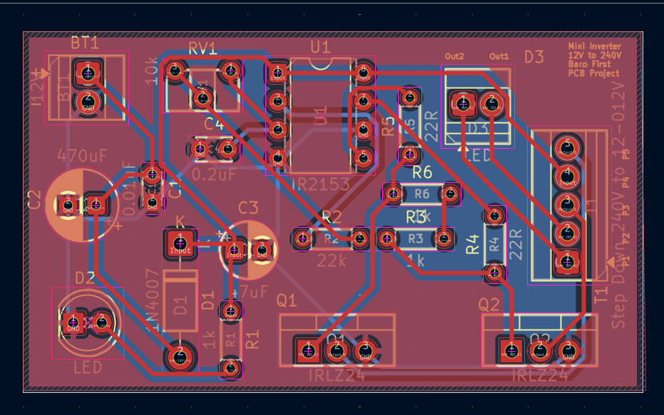
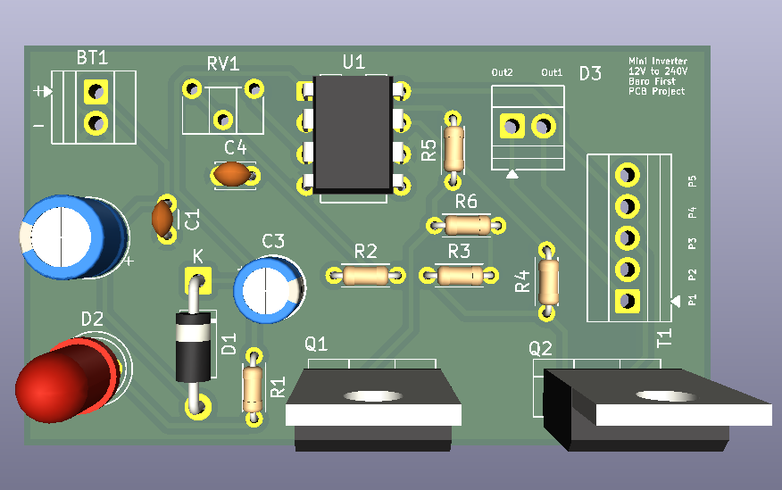

# Mini Inverter PCB | My First KiCad Project

A two-layer PCB design exploring a **12V DC-to-AC inverter** using an IR2153 gate driver, two IRLZ24 MOSFETs, and an external transformer. The intended step-up stage targets approximately **240V AC**, but the output has **not been verified**.

This is my first KiCad project, created to practice schematic capture, footprint selection, component placement, PCB routing, and manufacturing-file export.

*Top-view visualization generated from the exported Gerber layers. This is a design preview, not a photograph or a finished 3D rendering.*

## Project Overview

| Specification | Design |
| --- | --- |
| EDA software | KiCad 10 |
| PCB layers | 2 (front and back copper) |
| Board dimensions | Approximately 55.2 × 32.2 mm |
| Board thickness setting | 1.6 mm |
| Input | Nominal 12V DC |
| Intended output | Approximately 240V AC via an external transformer; **unverified** |
| Current stage | PCB design and Gerber export; fabrication/testing not documented |

## Circuit Design

The design explores converting a low-voltage DC supply into an alternating signal that can be applied to a step-up transformer. The **IR2153** is used as a self-oscillating MOSFET driver, while **Q1 and Q2 (IRLZ24)** are the switching devices. The schematic also includes timing/passive components, a potentiometer, an indicator LED, and terminal blocks for external connections.

### Main Components

| Reference | Component | Role in design |
| --- | --- | --- |
| U1 | IR2153 | Self-oscillating gate-driver IC |
| Q1, Q2 | IRLZ24 | N-channel switching MOSFETs |
| T1 | 240V / 12-0-12V transformer (external) | Intended voltage-conversion stage, connected through a terminal block |
| RV1 | 10 kΩ potentiometer | Adjustable element in the circuit |
| BT1 | 12V supply connection | Input terminal block |
| D1 | 1N4007 | Diode |
| D2 | LED | Indicator |
| R1–R6, C1–C4 | Resistors and capacitors | Supporting driver, timing, and filtering circuitry |

## PCB Layout and Routing

The board uses through-hole components and a two-layer copper layout. Its compact footprint was an opportunity to practice component placement, trace routing, copper pours, and silkscreen labeling.

*Copper-layer visualization derived from the Gerber files; the layers are overlaid for illustration.*

## Project Status

- [x] Create schematic and select component footprints
- [x] Design and route the PCB
- [x] Export Gerber and drill files
- [ ] Document electrical-rule and design-rule check results
- [ ] Review the design for high-voltage safety and component ratings
- [ ] Fabricate and assemble the PCB
- [ ] Test the circuit and record measured output

### Items to Review Before Fabrication

- **D3 is an LED symbol assigned to a two-pin terminal-block footprint.** If it represents an output connector, update the schematic symbol so the documentation matches the physical design.
- Verify the **transformer wiring, terminal-block voltage ratings, insulation, creepage/clearance distances, and protection circuitry**. The present files do not establish that the board is safe to produce or energize at the intended high voltage.
- Record and resolve KiCad **ERC/DRC findings** and independently check circuit operation before manufacturing.

 **Safety:** This is an educational, unvalidated design that targets potentially lethal voltages. It should not be connected to mains wiring or energized at high voltage without a qualified design and safety review.

## What I Learned

This project gave me hands-on experience with the workflow from a schematic to a routed PCB, including assigning footprints, organizing components on a compact board, working with two copper layers, and exporting manufacturing files. The next step is validating the electrical design and documenting test results before considering fabrication.
